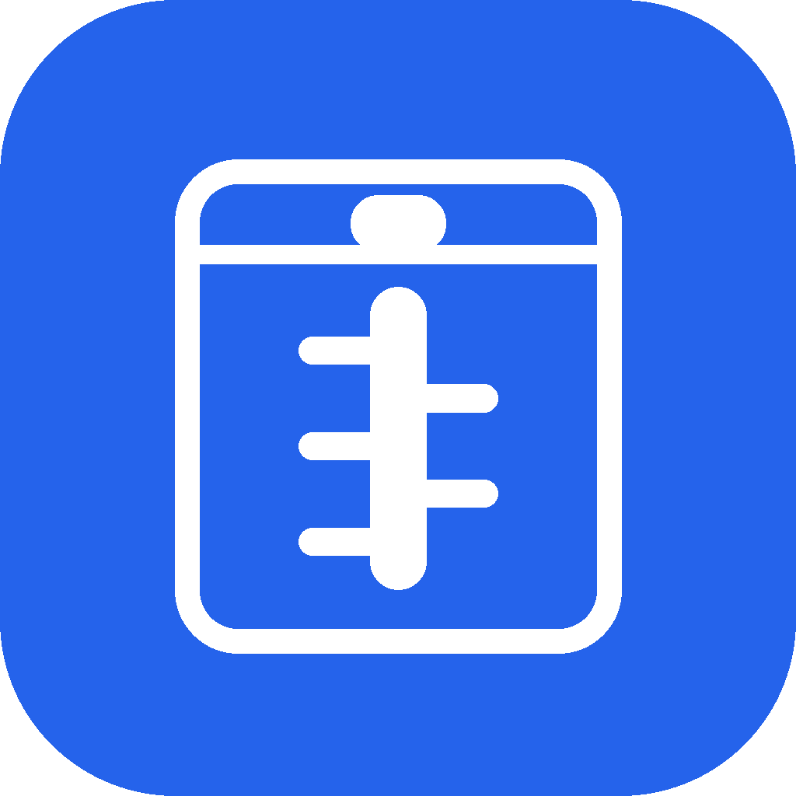
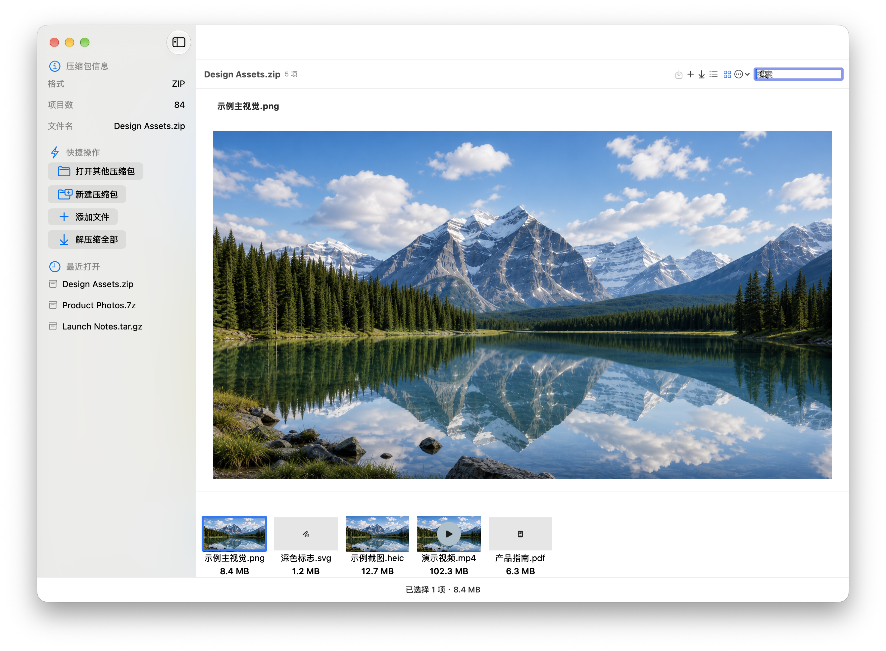

<p align="center">
  
</p>

<h1 align="center">MacUnzip</h1>

<p align="center">Browse, preview, extract, and create archives on your Mac.</p>

<p align="center">
  <a href="https://github.com/smkzw/Mac-Unzip/releases"><strong>Download on GitHub</strong></a>
</p>

<p align="center">
  <a href="README_zh.md">简体中文</a> ·
  <a href="ArchiveWorkbench/README_fr.md">Français</a> ·
  <a href="ArchiveWorkbench/README_es.md">Español</a> ·
  <a href="ArchiveWorkbench/README_it.md">Italiano</a> ·
  <a href="ArchiveWorkbench/README_ja.md">日本語</a> ·
  <a href="ArchiveWorkbench/README_ko.md">한국어</a>
</p>

<p align="center">
  
  
  
  <a href="LICENSE"></a>
</p>



## Browse, preview, extract

Drop an archive into the window to browse or search its contents. Open supported nested archives, extract selected files, or extract the whole archive. Preview supported images, videos, PDFs, Markdown, and Office documents inside the app. Preview availability depends on the file and the system. Some previews use temporary local storage.

Start a new archive by dropping in files and folders. Creation includes a preflight check, format-specific compression settings, and AES-256 protection for ZIP and 7z. ZIP also has a Windows compatibility preset.

[Welcome screen](ArchiveWorkbench/Assets/screenshots/app_welcome.png) · [Dark mode](ArchiveWorkbench/Assets/screenshots/app_media_dark.png) · [Create an archive](ArchiveWorkbench/Assets/screenshots/creation.png)

The screenshots show fictional example files.

## Supported formats

| Format | Browse and extract | Create |
| --- | --- | --- |
| ZIP | Yes, including supported AES and ZipCrypto archives | Yes |
| TAR, TAR.GZ, TAR.BZ2, TAR.XZ, TAR.ZST | Yes | TAR.GZ, TAR.XZ, TAR.ZST |
| 7z | Yes, including supported password-protected archives | Yes |
| RAR | With `7zz`. Some methods use the external RARLAB tool when available | With the external [RARLAB `rar` tool](https://www.rarlab.com/download.htm) |
| DMG, ISO | Read-only access to supported images via `7zz`, with extraction to a separate destination | — |

## Install

MacUnzip requires **macOS 26 or later on Apple silicon (arm64)**.

1. Open [GitHub Releases](https://github.com/smkzw/Mac-Unzip/releases) and choose a release with a DMG asset.
2. Open the DMG and drag **MacUnzip** to **Applications**. Refer to the release notes for signing and verification details.
3. Release builds of v1.3.0 include 7-Zip `7zz` 26.03 (arm64) for 7z, with no Homebrew setup required. RAR creation still uses the separately installed RARLAB `rar` tool.

## Build from source

Use **Xcode 26 with the Swift 6.2 toolchain** and Homebrew. Run the following commands from an Apple silicon Mac.

```sh
git clone https://github.com/smkzw/Mac-Unzip.git
cd Mac-Unzip/ArchiveWorkbench
brew install libarchive xz zstd lz4 libb2
open MacUnzip.xcodeproj
```

In Xcode, select the **MacUnzip** scheme and **My Mac**, then run. A Debug build from source can use a detected external [7-Zip `7zz`](https://www.7-zip.org/download.html). The checked-in project can be regenerated with XcodeGen after editing `project.yml`. [Build and distribution guide](ArchiveWorkbench/Distribution/BUILD_PROFILES.md)

## Security and privacy

Archive handling runs locally. Extraction applies path checks and resource limits, with additional checks for unsafe entries according to the selected engine. Settings and recent archives are stored locally. The optional engine-version check is off by default and retrieves version metadata when requested. It does not download or replace executables.

## License and feedback

MacUnzip is released under the [MIT License](LICENSE). Third-party components retain their own licenses. [Third-party notices](ArchiveWorkbench/Distribution/THIRD_PARTY_NOTICES.md) · [Source dependency inventory](ArchiveWorkbench/Distribution/SBOM.spdx.json)

Report issues on [GitHub](https://github.com/smkzw/Mac-Unzip/issues). For build and signing documentation, see the [engineering entry point](ArchiveWorkbench/README.md).
