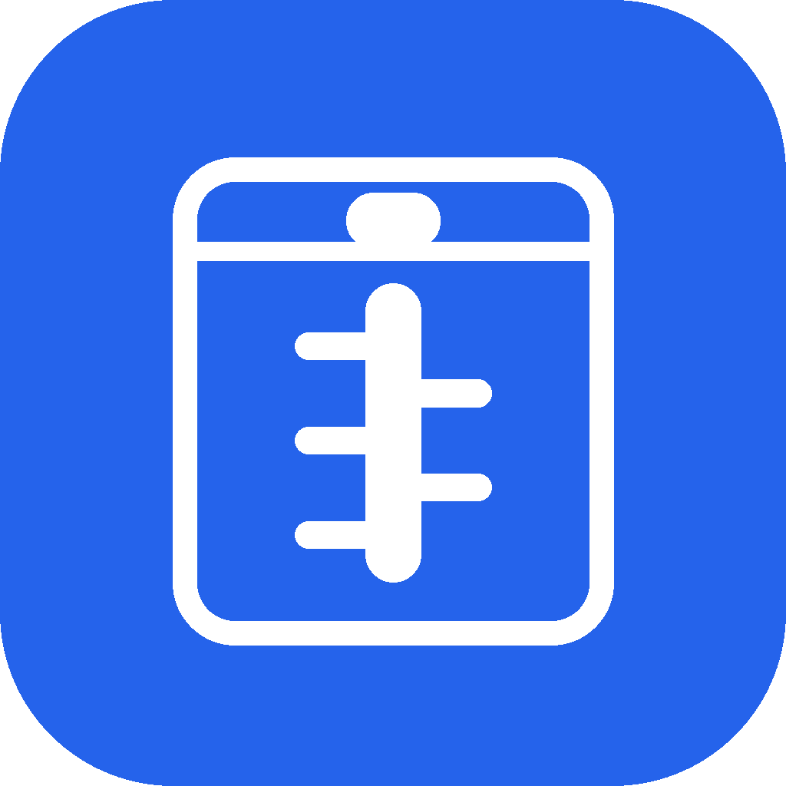
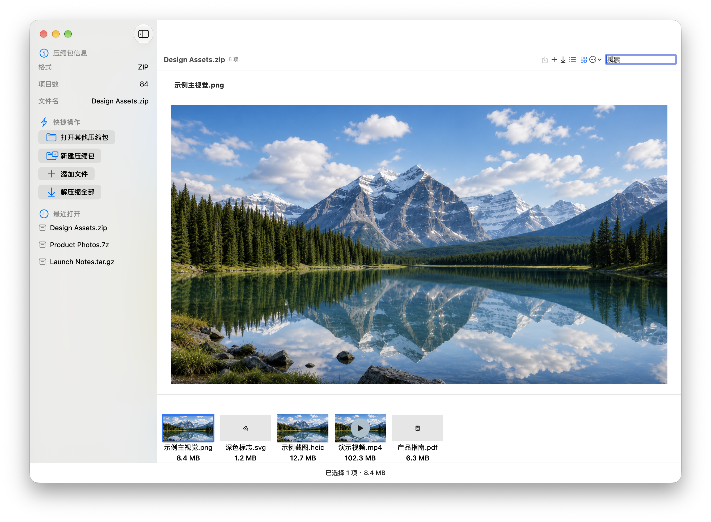

<p align="center">
  
</p>

<h1 align="center">Mac 解霸</h1>

<p align="center">在 macOS 上浏览、预览、解压和创建压缩包。</p>

<p align="center">
  <a href="https://github.com/smkzw/Mac-Unzip/releases"><strong>前往 GitHub 下载</strong></a>
</p>

<p align="center">
  <a href="README.md">English</a> ·
  <a href="ArchiveWorkbench/README_fr.md">Français</a> ·
  <a href="ArchiveWorkbench/README_es.md">Español</a> ·
  <a href="ArchiveWorkbench/README_it.md">Italiano</a> ·
  <a href="ArchiveWorkbench/README_ja.md">日本語</a> ·
  <a href="ArchiveWorkbench/README_ko.md">한국어</a>
</p>

<p align="center">
  
  
  
  <a href="LICENSE"></a>
</p>



## 浏览、预览与解压

将压缩包拖入窗口即可浏览和搜索内容。可打开受支持的嵌套压缩包、选择文件解压，或提取整个压缩包。应用内可预览受支持的图片、视频、PDF、Markdown 和 Office 文档。预览取决于文件和系统支持，部分预览会使用本地临时存储。

拖入文件和文件夹即可开始创建压缩包。创建流程包含预检，可按格式调整压缩设置。ZIP 和 7z 支持 AES-256 加密，ZIP 另有 Windows 兼容性预设。

[欢迎页](ArchiveWorkbench/Assets/screenshots/app_welcome.png) · [深色模式](ArchiveWorkbench/Assets/screenshots/app_media_dark.png) · [创建压缩包](ArchiveWorkbench/Assets/screenshots/creation.png)

截图中的文件均为虚构示例。

## 支持的格式

| 格式 | 浏览与解压 | 创建 |
| --- | --- | --- |
| ZIP | 支持，包括受支持的 AES 和 ZipCrypto 加密压缩包 | 支持 |
| TAR、TAR.GZ、TAR.BZ2、TAR.XZ、TAR.ZST | 支持 | TAR.GZ、TAR.XZ、TAR.ZST |
| 7z | 支持，包括受支持的密码保护压缩包 | 支持 |
| RAR | 通过 `7zz` 读取，部分压缩方法可在外部工具可用时使用 RARLAB 引擎解压 | 需要外部 [RARLAB 官方 `rar` 工具](https://www.rarlab.com/download.htm) |
| DMG、ISO | 通过 `7zz` 以只读方式打开受支持的镜像，可将文件提取到其他目录 | — |

## 安装

需要搭载 **Apple 芯片（arm64）**、运行 **macOS 26 或以上版本**的 Mac。

1. 前往 [GitHub Releases](https://github.com/smkzw/Mac-Unzip/releases)，选择提供 DMG 的版本。
2. 打开 DMG，将 **Mac 解霸**拖入 **应用程序**。签名和校验信息见对应版本说明。
3. v1.3.0 的 Release 构建内置 7-Zip `7zz` 26.03（arm64），使用 7z 无需安装 Homebrew。创建 RAR 仍需另行安装 RARLAB 官方 `rar`。

## 从源码构建

在 Apple 芯片 Mac 上使用 **Xcode 26（Swift 6.2 工具链）**和 Homebrew。

```sh
git clone https://github.com/smkzw/Mac-Unzip.git
cd Mac-Unzip/ArchiveWorkbench
brew install libarchive xz zstd lz4 libb2
open MacUnzip.xcodeproj
```

在 Xcode 中选择 **MacUnzip** scheme 和 **My Mac**，然后运行。源码 Debug 构建可使用已检测到的外部 [7-Zip `7zz`](https://www.7-zip.org/download.html)。修改 `project.yml` 后，可用 XcodeGen 重新生成工程。 [构建与分发指南](ArchiveWorkbench/Distribution/BUILD_PROFILES.md)

## 安全与隐私

压缩包在本机处理。解压会检查路径并限制资源用量，按所用引擎额外检查不安全的归档条目。设置和最近打开记录保存在本机。引擎版本检查默认关闭，启用后可手动联网读取版本号；该操作不会下载或替换可执行文件。

## 许可与反馈

Mac 解霸采用 [MIT 许可证](LICENSE)，第三方组件适用各自的许可证。 [第三方许可声明](ArchiveWorkbench/Distribution/THIRD_PARTY_NOTICES.md) · [源码依赖清单](ArchiveWorkbench/Distribution/SBOM.spdx.json)

欢迎在 [GitHub](https://github.com/smkzw/Mac-Unzip/issues) 提交问题。构建与签名文档见[工程入口](ArchiveWorkbench/README_zh.md)。
